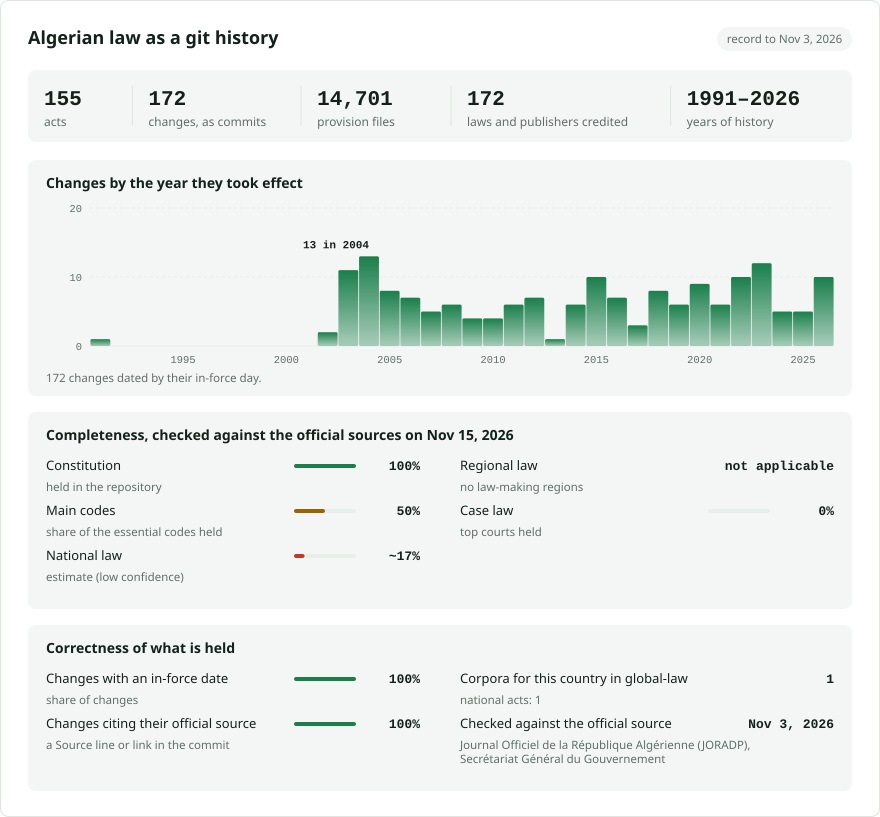

# Algeria: law history in git

[Français](README.md) · **English**

<picture>
<source media="(prefers-color-scheme: dark)" srcset="data/effort-dark.svg">

</picture>

The law of Algeria as a git history: one file per article, one commit per version on the day it took effect, and the law that made each change as the commit's author. `git blame` names the law behind every paragraph; `git log` lists every change to an article; picking a date gives the text in force that day.

Part of [lexifina/global-law](https://github.com/lexifina/global-law), one git history for every country's law: this is Algeria's national law, which global-law reads at `algeria/national/acts/`.

**What is in it now:** the Constitution (as revised in 2020, with its revision of 26 March 2026), six codes and 148 other laws, organic laws and ordinances published from 2002 to 2026: 155 acts with 172 versions. The Code pénal has 12 versions, from the Ministry of Justice's 2005 edition through eleven amending laws and ordinances to October 2026; 148 acts are here only as enacted. [`data/laws.csv`](data/laws.csv) lists the 195 laws the record names, with their dates and sources.

Each act is a folder with one file per article: the Constitution is in `constitution/constitution/`, the six codes in `code/<name>/` (`code/code-penal/` is the Code pénal), and every other act in `<kind>/<year>/<number>/` (`loi/2023/23-08/` is Loi n° 23-08 of 21 June 2023 on collective labour disputes and the right to strike). Until 11 November 2026 each folder was named by the act's id (`code-penal/`); [`data/paths.json`](data/paths.json) maps each id to its folder, and the version tags (`code-penal/2014-02-16`) keep the ids.

The text is in French, as the French edition of the Journal Officiel prints it. The Arabic original and an English translation are not part of this record.

## Questions as git commands

| Question | Command |
| --- | --- |
| Every change to Article 87 bis of the Code pénal | `git log -p --follow --word-diff -- code/code-penal/art-087-bis.md` |
| Which law wrote each line of Article 87 bis? | `git blame code/code-penal/art-087-bis.md` |
| Every version of the Code pénal, with the day each took effect | `git log --no-walk --tags="code-penal/*" --format="%h %(trailers:key=In-force,valueonly,separator=) %an"` |
| Article 87 bis as in force from 16 February 2014 | `git show code-penal/2014-02-16:code-penal/art-087-bis.md` |

**Outside git**, we also host this record publicly, for free:

- **[Ask Claude about Algerian law](https://global-law.lexifina.com/v1/try_claude?country=algeria)**: opens Claude with a first question ready.
- **[Ask ChatGPT](https://global-law.lexifina.com/v1/try_chatgpt?country=algeria)**: the same question in ChatGPT.
- **[Search Algerian law on our site](https://lexifina.com/law?country=algeria&q=pension+alimentaire)**: a search for "pension alimentaire", with each provision's text and its versions, no account needed.
- **[Developer REST API](https://global-law.lexifina.com/v1/search_law?query=pension+alimentaire&jurisdiction=algeria)**: the same search as JSON, with no key. See the [documentation here](https://lexifina.com/api/global-law).

Both assistants read the record through the free Global law connector (MCP, `https://global-law.lexifina.com/mcp`); the first time, the chat gives you the link that adds it. Ask in French or in English.

**Host it yourself easily.** All it takes is git and Python, and the tools run on your machine:

```sh
git clone --depth 1 https://github.com/lexifina/global-law && cd global-law
python3 tools/countries.py add algeria/national/acts
python3 tools/law.py show 2026-01-01 algeria/national/acts/code/code-penal/art-087-bis.md
```

Opened in Claude Code, Cursor, VS Code or Codex, the clone also starts a local MCP server with the same tools ([MCP.md](https://github.com/lexifina/global-law/blob/main/MCP.md)).

## Dates

Each commit is dated at noon, Africa/Algiers, on the day the version took effect, and carries it in its `In-force:` trailer:

- a law or ordinance takes effect on publication, so each version is dated by the issue of the Journal Officiel that printed it; a commencement clause inside a law is not applied, except for the Code de procédure civile et administrative, dated 23 April 2009, the day its article 1062 sets (one year after publication);
- the Constitution of 2020 took effect on its promulgation and publication, 30 December 2020;
- the first version of the Code pénal is dated 23 August 2005, the last amending text the Ministry's edition includes (Ordonnance n° 05-06); the edition itself carries no day.

Acts were added in batches, so `git log` over the whole repository is not in date order; the `In-force:` trailer gives each version's day.

Each version is credited to the law that made it (`Loi n° 24-06 <loi-24-06@joradp.invalid>`), the Constitution of 2020 to its promulgating decree (Décret présidentiel n° 20-442), and the Code pénal's 2005 text, the oldest version available, to its publisher. The committer is Lexifina.

## How it is checked

- Before a batch is pushed, every version is read back from git on the day it took effect and on the day before and must match the corpus it was built from, file by file (`tools/check_repo.py`).
- Every paragraph of an amended article must occur either in the gazette issue's own text or in the article's earlier text (`tools/journal/verify_dz.py`); each version's commit message names the articles that could not be applied.
- The same corpus always gives the same commit hashes; [`REPRODUCE.md`](REPRODUCE.md) gives the corpus's sha256 and the builders' blob hashes.
- History is append-only: no merge commits, no rewriting, no commit dated in the future, and every commit's trailers parse.
- [vulnerabilities/](vulnerabilities/README.en.md): possible drafting mistakes in Algerian law, found by global-law's detectors and checked by hand.

## What it does not show

- **Most of Algerian law.** Besides the Code pénal, only laws published since 2002 are here, and of those only the ones whose gazette text could be read whole. The Code civil and the Code de commerce (1975), printed in gazettes that are scanned images, are not yet; nor are decrees, other regulations or case law.
- **Later amendments, for most acts.** Amending laws are applied to some acts only, and only when every article they name can be found; a change to part of an article (an alinéa, a phrase, a word) only where its wording matches the earlier text. A text here may not be the one in force.
- **Repeals.** An act a later law repealed stays as enacted: Loi organique n° 16-10 on the electoral system is still here, although Ordonnance n° 21-01 (article 320) repealed it.
- **Earlier texts:** constitutions before 2020, the Code pénal before its 2005 edition, and the Code de procédure pénale of 1966 that the code of 2025 replaced.
- **Headings and footnotes.** Titles of books, chapters and sections are not recorded, nor the footnotes of the Code pénal's edition.

## Sources

| Source | Kind | Past versions | Notes |
| --- | --- | --- | --- |
| [Journal Officiel de la République Algérienne](https://www.joradp.dz) (Secrétariat Général du Gouvernement) | Official gazette, French edition | no consolidated texts: each law as printed; later versions apply the amending laws | The Constitution, every act as enacted and every amending law, from the text layer of each issue's PDF (no OCR) |
| [UNODC SHERLOC](https://sherloc.unodc.org): Ministère de la Justice, Code pénal, 4th edition (ONTE, 2005) | Official edition, French and Arabic (the French column is used) | its 2005 text only | The Code pénal's first version |

## Licence

See [`LICENSE`](LICENSE). Official texts are not protected by copyright in Algeria: Ordonnance n° 03-05 du 19 juillet 2003 relative aux droits d'auteur et aux droits voisins, article 11, excludes laws, regulations and their official translations. Lexifina's own contributions (the arrangement of the history, the commit messages, the tables and the tools) are dedicated to the public domain under CC0 1.0.

No AI model wrote, translated or corrected legal text, and none runs at build time; the scripts were written by an AI model (see [`REPRODUCE.md`](REPRODUCE.md)).

## Visualisations

- [visualisations/](visualisations/README.en.md): charts drawn from this repository. Not drawn yet.

## More

From [lexifina/global-law](https://github.com/lexifina/global-law):

- [FEATURES.md](https://github.com/lexifina/global-law/blob/main/FEATURES.md): every feature, and what every corpus must support (`git blame`, `law.py`, the MCP tools)
- [FAQ.md](https://github.com/lexifina/global-law/blob/main/FAQ.md): questions and answers · [CONTRIBUTING.md](https://github.com/lexifina/global-law/blob/main/CONTRIBUTING.md): proposing changes · [MCP.md](https://github.com/lexifina/global-law/blob/main/MCP.md): the MCP server · [REPRODUCE.md](https://github.com/lexifina/global-law/blob/main/REPRODUCE.md): how it was built · [CHANGELOG.md](https://github.com/lexifina/global-law/blob/main/CHANGELOG.md)
- [FRESHNESS.md](https://github.com/lexifina/global-law/blob/main/FRESHNESS.md): how current each corpus is · [Monitoring](https://github.com/lexifina/global-law/tree/main/monitoring): whether updates are running · [WATCHING.md](https://github.com/lexifina/global-law/blob/main/WATCHING.md): how each official source is watched for changes
- [performance/](https://github.com/lexifina/global-law/tree/main/performance): how fast the tools are, measured
- [visualisations/](https://github.com/lexifina/global-law/tree/main/visualisations): charts and bridges across the world's law
- [Vulnerabilities](https://github.com/lexifina/global-law/tree/main/vulnerabilities): mistakes in legislation as published
