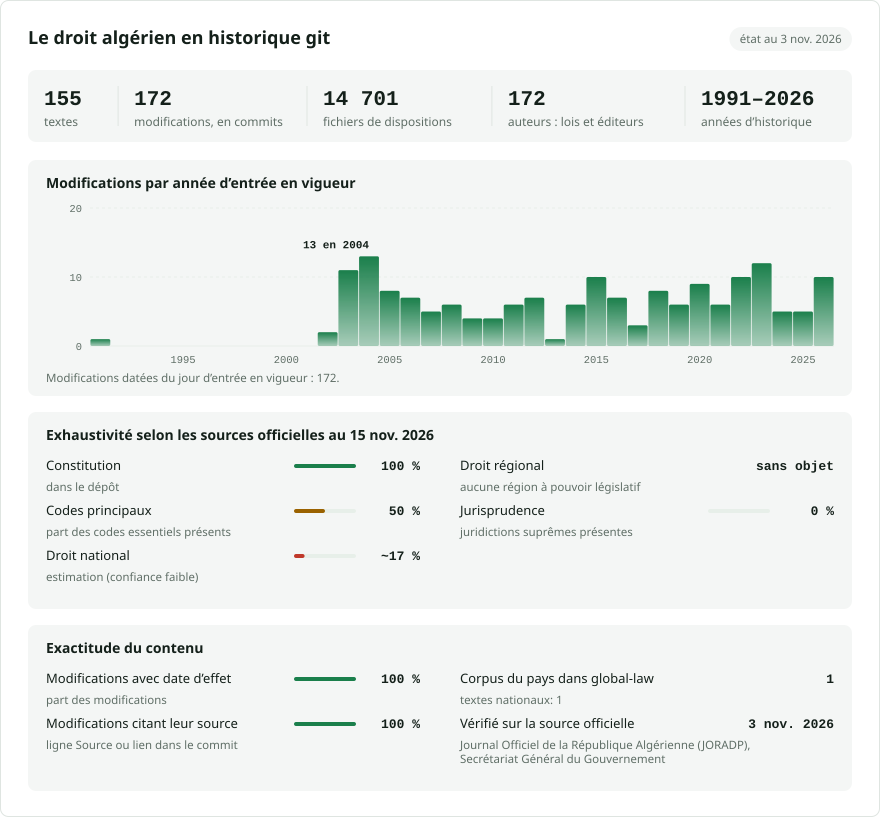

# Algérie : l’historique du droit dans git

**Français** · [English](README.en.md)

<picture>
<source media="(prefers-color-scheme: dark)" srcset="data/fr/effort-dark.svg">

</picture>

Le droit algérien sous forme d’historique git : un fichier par article, un commit par version au jour de son entrée en vigueur, et pour auteur de chaque commit la loi qui a apporté la modification. `git blame` désigne la loi à l’origine de chaque alinéa ; `git log` énumère toutes les modifications d’un article ; le choix d’une date donne le texte en vigueur ce jour-là.

Fait partie de [lexifina/global-law](https://github.com/lexifina/global-law), un historique git unique pour le droit de chaque pays : ce dépôt contient le droit national algérien, que global-law lit dans `algeria/national/acts/`.

**Contenu actuel :** la Constitution (telle que révisée en 2020, avec sa révision du 26 mars 2026), six codes et 148 autres lois, lois organiques et ordonnances publiées de 2002 à 2026 : 155 textes et 172 versions. Le Code pénal compte 12 versions, de l’édition 2005 du ministère de la Justice jusqu’à octobre 2026, à travers onze lois et ordonnances modificatives ; 148 textes ne figurent ici que tels qu’adoptés. [`data/laws.csv`](data/laws.csv) énumère les 195 lois que mentionne le registre, avec leurs dates et leurs sources.

Chaque texte est un dossier comportant un fichier par article : la Constitution se trouve dans `constitution/constitution/`, les six codes dans `code/<name>/` (`code/code-penal/` est le Code pénal), et tout autre texte dans `<kind>/<year>/<number>/` (`loi/2023/23-08/` est la loi n° 23-08 du 21 juin 2023 sur les conflits collectifs de travail et le droit de grève). Jusqu’au 11 novembre 2026, chaque dossier portait l’identifiant du texte (`code-penal/`) ; [`data/paths.json`](data/paths.json) fait correspondre chaque identifiant à son dossier, et les tags de version (`code-penal/2014-02-16`) conservent les identifiants.

Le texte est en français, tel que l’imprime l’édition française du Journal officiel. L’original arabe et une traduction anglaise ne font pas partie de ce registre.

## Questions sous forme de commandes git

| Question | Commande |
| --- | --- |
| Toutes les modifications de l’article 87 bis du Code pénal | `git log -p --follow --word-diff -- code/code-penal/art-087-bis.md` |
| Quelle loi a écrit chaque ligne de l’article 87 bis ? | `git blame code/code-penal/art-087-bis.md` |
| Toutes les versions du Code pénal, avec le jour d’entrée en vigueur de chacune | `git log --no-walk --tags="code-penal/*" --format="%h %(trailers:key=In-force,valueonly,separator=) %an"` |
| L’article 87 bis tel qu’en vigueur à compter du 16 février 2014 | `git show code-penal/2014-02-16:code-penal/art-087-bis.md` |

**En dehors de git**, nous hébergeons aussi ce registre publiquement, gratuitement :

- **[Interroger Claude sur le droit algérien](https://global-law.lexifina.com/v1/try_claude?country=algeria)** : ouvre Claude avec une première question prête.
- **[Interroger ChatGPT](https://global-law.lexifina.com/v1/try_chatgpt?country=algeria)** : la même question dans ChatGPT.
- **[Rechercher dans le droit algérien sur notre site](https://lexifina.com/law?country=algeria&q=pension+alimentaire)** : une recherche de « pension alimentaire », avec le texte de chaque disposition et ses versions, sans compte.
- **[API REST pour les développeurs](https://global-law.lexifina.com/v1/search_law?query=pension+alimentaire&jurisdiction=algeria)** : la même recherche en JSON, sans clé. Voir la [documentation ici](https://lexifina.com/api/global-law).

Les deux assistants lisent le registre au moyen du connecteur gratuit Global law (MCP, `https://global-law.lexifina.com/mcp`) ; la première fois, la conversation vous donne le lien qui l’ajoute. Posez vos questions en français ou en anglais.

**L’héberger vous-même, simplement.** Il suffit de git et de Python, et les outils s’exécutent sur votre machine :

```sh
git clone --depth 1 https://github.com/lexifina/global-law && cd global-law
python3 tools/countries.py add algeria/national/acts
python3 tools/law.py show 2026-01-01 algeria/national/acts/code/code-penal/art-087-bis.md
```

Ouvert dans Claude Code, Cursor, VS Code ou Codex, le clone lance aussi un serveur MCP local doté des mêmes outils ([MCP.md](https://github.com/lexifina/global-law/blob/main/MCP.md)).

## Dates

Chaque commit est daté à midi, heure d’Alger (Africa/Algiers), du jour où la version est entrée en vigueur, et porte ce jour dans son trailer `In-force:` :

- une loi ou une ordonnance entre en vigueur dès sa publication ; chaque version est donc datée du numéro du Journal officiel qui l’a publiée ; une clause d’entrée en vigueur contenue dans une loi n’est pas appliquée, sauf pour le Code de procédure civile et administrative, daté du 23 avril 2009, jour que fixe son article 1062 (un an après sa publication) ;
- la Constitution de 2020 est entrée en vigueur lors de sa promulgation et de sa publication, le 30 décembre 2020 ;
- la première version du Code pénal est datée du 23 août 2005, date du dernier texte modificatif que comprend l’édition du ministère (ordonnance n° 05-06) ; l’édition elle-même ne porte aucune date.

Les textes ont été ajoutés par lots ; `git log` sur l’ensemble du dépôt ne suit donc pas l’ordre chronologique ; le trailer `In-force:` donne le jour de chaque version.

Chaque version est attribuée à la loi qui l’a faite (`Loi n° 24-06 <loi-24-06@joradp.invalid>`), la Constitution de 2020 à son décret de promulgation (décret présidentiel n° 20-442), et le texte de 2005 du Code pénal, la plus ancienne version disponible, à son éditeur. Le committer est Lexifina.

## Comment il est vérifié

- Avant l’envoi d’un lot, chaque version est relue depuis git au jour de son entrée en vigueur et la veille, et doit correspondre, fichier par fichier, au corpus à partir duquel elle a été construite (`tools/check_repo.py`).
- Chaque alinéa d’un article modifié doit figurer soit dans le texte même du numéro du journal officiel, soit dans le texte antérieur de l’article (`tools/journal/verify_dz.py`) ; le message de commit de chaque version nomme les articles qui n’ont pas pu être appliqués.
- Le même corpus donne toujours les mêmes empreintes de commit ; [`REPRODUCE.md`](REPRODUCE.md) indique le sha256 du corpus et les empreintes des blobs des scripts de construction.
- L’historique ne fait l’objet que d’ajouts : aucun commit de fusion, aucune réécriture, aucun commit daté dans le futur, et les trailers de chaque commit se lisent sans erreur.

## Ce qu’il ne montre pas

- **La majeure partie du droit algérien.** Outre le Code pénal, seules figurent ici des lois publiées depuis 2002, et parmi celles-ci uniquement celles dont le texte au journal officiel a pu être lu en entier. Le Code civil et le Code de commerce (1975), imprimés dans des numéros numérisés en image, n’y figurent pas encore ; ni les décrets, ni les autres textes réglementaires, ni la jurisprudence.
- **Les modifications ultérieures, pour la plupart des textes.** Les lois modificatives ne sont appliquées qu’à certains textes, et seulement lorsque chaque article qu’elles visent peut être retrouvé ; une modification d’une partie d’article (un alinéa, une phrase, un mot) ne l’est que lorsque sa rédaction concorde avec le texte antérieur. Un texte figurant ici peut ne pas être celui en vigueur.
- **Les abrogations.** Un texte abrogé par une loi ultérieure reste tel qu’adopté : la loi organique n° 16-10 relative au régime électoral figure toujours ici, bien que l’ordonnance n° 21-01 (article 320) l’ait abrogée.
- **Les textes antérieurs :** les constitutions antérieures à 2020, le Code pénal avant son édition de 2005, et le Code de procédure pénale de 1966, que le code de 2025 a remplacé.
- **Les intitulés et les notes de bas de page.** Les intitulés des livres, chapitres et sections ne sont pas enregistrés, pas plus que les notes de bas de page de l’édition du Code pénal.

## Sources

| Source | Nature | Versions antérieures | Remarques |
| --- | --- | --- | --- |
| [Journal Officiel de la République Algérienne](https://www.joradp.dz) (Secrétariat Général du Gouvernement) | Journal officiel, édition française | pas de textes consolidés : chaque loi telle que publiée ; les versions ultérieures appliquent les lois modificatives | La Constitution, chaque texte tel qu’adopté et chaque loi modificative, à partir de la couche texte du PDF de chaque numéro (sans OCR) |
| [UNODC SHERLOC](https://sherloc.unodc.org) : Ministère de la Justice, Code pénal, 4e édition (ONTE, 2005) | Édition officielle, en français et en arabe (la colonne française est utilisée) | son seul texte de 2005 | La première version du Code pénal |

## Licence

Voir [`LICENSE`](LICENSE). Les textes officiels ne sont pas protégés par le droit d’auteur en Algérie : l’ordonnance n° 03-05 du 19 juillet 2003 relative aux droits d’auteur et aux droits voisins, en son article 11, exclut les lois, les règlements et leurs traductions officielles. Les contributions propres de Lexifina (l’agencement de l’historique, les messages de commit, les tableaux et les outils) sont versées au domaine public sous CC0 1.0.

Aucun modèle d’IA n’a écrit, traduit ou corrigé de texte juridique, et aucun n’est exécuté lors de la construction ; les scripts ont été écrits par un modèle d’IA (voir [`REPRODUCE.md`](REPRODUCE.md)).

Ceci est une traduction de la version anglaise ([README.en.md](README.en.md)) ; en cas de divergence, la version anglaise fait foi.

## En savoir plus

Dans le dépôt [lexifina/global-law](https://github.com/lexifina/global-law) (pages en anglais) :

- [FEATURES.md](https://github.com/lexifina/global-law/blob/main/FEATURES.md): toutes les fonctionnalités et ce que chaque corpus doit prendre en charge (`git blame`, `law.py`, outils MCP)
- [FAQ.md](https://github.com/lexifina/global-law/blob/main/FAQ.md): questions et réponses · [CONTRIBUTING.md](https://github.com/lexifina/global-law/blob/main/CONTRIBUTING.md): proposer une modification · [MCP.md](https://github.com/lexifina/global-law/blob/main/MCP.md): serveur MCP · [REPRODUCE.md](https://github.com/lexifina/global-law/blob/main/REPRODUCE.md): comment il a été construit · [CHANGELOG.md](https://github.com/lexifina/global-law/blob/main/CHANGELOG.md)
- [FRESHNESS.md](https://github.com/lexifina/global-law/blob/main/FRESHNESS.md): à quel point chaque corpus est à jour · [Surveillance](https://github.com/lexifina/global-law/tree/main/monitoring): si les mises à jour fonctionnent · [WATCHING.md](https://github.com/lexifina/global-law/blob/main/WATCHING.md): comment chaque source officielle est surveillée pour repérer les modifications
- [performance/](https://github.com/lexifina/global-law/tree/main/performance): la rapidité des outils, mesurée
- [visualisations/](https://github.com/lexifina/global-law/tree/main/visualisations): graphiques et liens à travers le droit du monde entier
- [Vulnérabilités](https://github.com/lexifina/global-law/tree/main/vulnerabilities): erreurs dans les textes tels qu’ils ont été publiés
