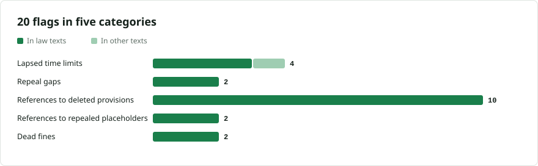

# Vulnerabilities in Algerian law

[Français](README.md) · **English**

<picture>
<source media="(prefers-color-scheme: dark)" srcset="img/flags-by-category-dark.svg">

</picture>

The vulnerability detectors from [lexifina/global-law](https://github.com/lexifina/global-law/tree/main/vulnerabilities) look for mechanical mistakes in legislation: a rule applying "until" a date that has passed, a provision repealed before its replacement took effect, two amendments to the same provision on the same day, a reference to an article that no longer exists. global-law's published list (9 November 2026) did not include Algeria, so this is a run over this repository only, as it stood at commit [`1be824b`](https://github.com/lexifina/algeria-law/commit/1be824b553ef2bfcdc2349fac5c434eaa89551cd) on 16 November 2026: the Constitution, six codes and 148 laws, organic laws and ordinances published from 2002 to 2026.

**In short:** the detectors raised 20 flags. A language model reviewed the 16 in the categories it reviews, arguing each one for and against; one survived. Checked by hand in this repository, it is not a mistake in Algerian law: Article 23 of the Code pénal, removed by Law No. 06-23 in 2006 and brought back by Law No. 24-06 in 2024, now holds a different rule altogether, and the ban on practising a profession it used to provide for has been in Article 16 bis since 2006. Among the flags the model set aside, four articles of the Code pénal still refer, in this repository's text, to repealed articles: Articles 204 and 213 to "la confiscation prévue à l'article 25" and Article 160 octies to "l'article 8 du code pénal", two articles Law No. 06-23 removed in 2006 (confiscation of objects is now in Article 16, and Article 9 bis 1 defines the ban on exercising civic, civil and family rights), and Article 435 to Articles 427 and 428, which read only as repealed (seven flags, four of them on Article 435). The model judged the first three lawful, as each reference was right when it was written; it does not review the fourth. This repository does not apply every amendment to the Code pénal, so whether these references have since been corrected needs the official text in force. The other 12 flags are spent transitional rules, a historical period, an article number used again for another rule, references to other codes or to sections, references to a run of articles, and a sentence in the English README. Later, this will be formalised in Lean, similar to our work on [the US tax code](https://lexifina.com/blog/formalizing-the-us-tax-code) and [US case law](https://lexifina.com/blog/formalizing-all-us-case-law-in-lean).

A flag is a prompt to look, not legal advice, and nothing here has been tested in court.

## Flags by category

| Category | What it looks for | Flags | In law texts | Reviewed | Survived review |
| --- | --- | ---: | ---: | ---: | ---: |
| Lapsed time limits | Text still applying a rule "until" a date that has passed | 4 | 3 | 4 | 0 |
| Repeal gaps | A provision removed before its replacement took effect | 2 | 2 | 2 | 1 |
| References to deleted provisions | A provision citing an article that no longer exists | 10 | 10 | 10 | 0 |
| References to repealed placeholders | A provision citing an article that now reads only as repealed | 2 | 2 | 0 | 0 |
| Dead fines | A penalty for breaching an article that has been repealed | 2 | 2 | 0 | 0 |

"In law texts" counts all the law this repository holds: the Constitution, the codes, the laws, the organic laws and the ordinances. The one other flag is in this repository's English README. 148 of the 155 texts are held only as adopted; only the Code pénal (12 versions), the Code de procédure civile et administrative, the Constitution, Ordinance No. 21-01 on the electoral system (an organic law) and Laws No. 03-03, 04-02 and 11-10 have a later version. So the history detectors have little to read: the repeal gaps and the references to deleted provisions all come from the Code pénal, the Code de procédure civile et administrative and Ordinance No. 21-01, and the search for same-day conflicts, retroactive dates, empty periods and stale amounts found nothing. Each version is credited to one text and, with few exceptions, dated by the issue of the Journal officiel that published it; the Code pénal's first version is the Ministry of Justice's 2005 edition, which the history credits to its publisher. The law in this repository has only three articles where "jusqu'au" comes before a date, and the time-limit search flagged all three.

*Edge cases: the flag that survived the review, checked by hand, and what the other flags are, in [EDGE-CASES.en.md](EDGE-CASES.en.md).*

## Problems found in this repository

- **Texts that run on into the next text in the Journal officiel:** the last article of five texts also holds the start of the text printed after it. [Article 4 of Law No. 04-06](https://github.com/lexifina/algeria-law/blob/1be824b553ef2bfcdc2349fac5c434eaa89551cd/loi/2004/04-06/art-004.md) (architects) goes on with the title and recitals of Law No. 04-07 on hunting, and its files `art-005.md` to `art-109.md` are, word for word, Articles 5 to 109 of Law No. 04-07; [Article 18 of Law No. 04-09](https://github.com/lexifina/algeria-law/blob/1be824b553ef2bfcdc2349fac5c434eaa89551cd/loi/2004/04-09/art-018.md) (renewable energy) goes on with the title and recitals of Law No. 04-10 on physical education and sport, and its files `art-019.md` to `art-114.md` are Articles 19 to 114 of Law No. 04-10. Each of the two laws' READMEs lists these articles. [Article 64 of Law No. 07-01](https://github.com/lexifina/algeria-law/blob/1be824b553ef2bfcdc2349fac5c434eaa89551cd/loi/2007/07-01/art-064.md) holds the title and recitals of Law No. 07-02, [Article 20 of Law No. 07-02](https://github.com/lexifina/algeria-law/blob/1be824b553ef2bfcdc2349fac5c434eaa89551cd/loi/2007/07-02/art-020.md) a correction to the finance law for 2007 and the title and recitals of Executive Decree No. 07-72, and [Article 84 of Law No. 24-02](https://github.com/lexifina/algeria-law/blob/1be824b553ef2bfcdc2349fac5c434eaa89551cd/loi/2024/24-02/art-084.md) the title and recitals of Law No. 24-03.
- **A README that does not follow the history:** the [README of Ordinance No. 21-01](https://github.com/lexifina/algeria-law/blob/1be824b553ef2bfcdc2349fac5c434eaa89551cd/ordonnance/2021/21-01/README.md) on the electoral system gives one version, of 10 March 2021, and no changes to its articles, while the history applies Organic Law No. 26-05, in force on 4 April 2026, to 39 of its articles ([the change](https://github.com/lexifina/algeria-law/commit/012a90091eff5831038251f03e19f110b8edba84)).

## Files

| File | What it holds |
| --- | --- |
| [data/flags.csv](data/flags.csv) | Every flag, one row per provision and issue |
| [data/reviewed.csv](data/reviewed.csv) | The 16 flags the model reviewed, with its verdict and reason |
| [data/by_category.csv](data/by_category.csv) | The counts in the table above |
| [tools/](tools/) | The scripts that made this run |

Columns: `category` and `category_fr` (the category in English and French), `detector`, `kind` (`law` or `other`), `path` (the article in this repository), `date` (the date the flag turns on), `reference` (the text or line involved), `summary`, `score` (the detector's ranking, 0 to 1), `review` (`artefact`, `lawful` or `candidate_defect`), `survives_rebuttal`, `review_note` (the model's reason, in English), `url` (the article at the commit that was read).

## How it was made

- **Detectors:** global-law's [vulnerabilities/scripts](https://github.com/lexifina/global-law/tree/main/vulnerabilities/scripts), with the fixes in [tools/patch_detectors.py](tools/patch_detectors.py), run on this repository at commit `1be824b`. global-law's list did not include Algeria, so the history table the detectors read was built from this repository's own commits (the text that made each change, and the `In-force` and `Kind` trailers), counting the kinds `law`, `decree` (the Constitution as promulgated) and `publisher` (the 2005 edition of the Code pénal) as changes to the law: 172 commits. Paths from before the folder move of 11 November 2026 are mapped to each text's folder today through `data/paths.json`. Two detectors were fixed for this repository ([tools/](tools/README.md)): the dinar, a current currency, no longer counts as a dead one (all 39 flags in that category were fines and fees in dinars), and the word "abrogations" in an article in force is no longer taken for a repeal marker.
- **Model review:** gpt-5.4-mini, the 40 strongest flags per category, which here is every flag in the three categories it reviews; the lapsed time limits in law texts are the same, less the English README. One pass says whether a flag is real, a second argues that it is not. There were no empty periods to review. The model does not review references to repealed placeholders or dead fines.
- **Hand check:** the case that survived was read in this repository's history and texts; none is left open. This repository does not hold Law No. 06-23 itself: the articles it removed are the ones its commit message names. Every other flag was read, and the Code pénal's references to repealed articles were not checked against the official text in force.

To report a correction, open an issue with the provision and an official source.

## Licence

The lists and notes are Lexifina's, dedicated to the public domain under CC0 1.0, like the rest of this repository's own contributions. Quoted law text is as the Journal officiel de la République algérienne (French edition) prints it and, for the Code pénal's first version, as the Ministry of Justice's 2005 edition does; laws, regulations and their official translations are not protected by copyright in Algeria (Ordinance No. 03-05 of 19 July 2003, Article 11). See [LICENSE](../LICENSE).
