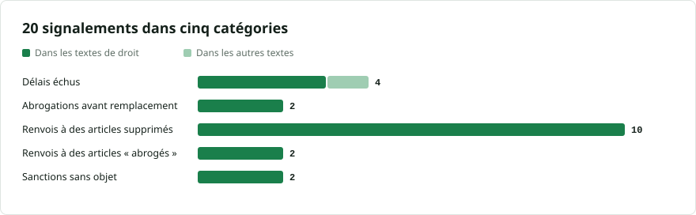

# Vulnérabilités du droit algérien

**Français** · [English](README.en.md)

<picture>
<source media="(prefers-color-scheme: dark)" srcset="img/flags-by-category-dark.fr.svg">

</picture>

Les détecteurs de vulnérabilités de [lexifina/global-law](https://github.com/lexifina/global-law/tree/main/vulnerabilities) recherchent les erreurs mécaniques de la législation : une règle qui s’applique encore « jusqu’au » une date déjà passée, une disposition abrogée avant l’entrée en vigueur de celle qui la remplace, deux modifications d’une même disposition le même jour, un renvoi à un article qui n’existe plus. La liste publiée par global-law le 9 novembre 2026 ne couvrait pas l’Algérie. Il s’agit donc d’une analyse de ce seul dépôt, dans l’état du commit [`1be824b`](https://github.com/lexifina/algeria-law/commit/1be824b553ef2bfcdc2349fac5c434eaa89551cd) du 16 novembre 2026 : la Constitution, six codes et 148 lois, lois organiques et ordonnances publiées de 2002 à 2026.

**En bref :** les détecteurs ont produit 20 signalements. Un modèle de langage a examiné les 16 qui relèvent des catégories qu’il examine, en pesant pour chacun les arguments pour et contre ; un seul a résisté. Vérifié à la main dans ce dépôt, ce n’est pas une erreur du droit algérien : l’article 23 du Code pénal, supprimé par la loi n° 06-23 en 2006 et rétabli par la loi n° 24-06 en 2024, porte depuis une tout autre règle, et l’interdiction d’exercer une profession qu’il prévoyait figure depuis 2006 à l’article 16 bis. Parmi les signalements écartés par le modèle, quatre articles du Code pénal renvoient encore, dans le texte de ce dépôt, à des articles abrogés : les articles 204 et 213 à « la confiscation prévue à l'article 25 » et l’article 160 octies à « l'article 8 du code pénal », deux articles que la loi n° 06-23 a supprimés en 2006 (la confiscation des objets figure désormais à l’article 16, et l’article 9 bis 1 définit l’interdiction d’exercer les droits civiques, civils et de famille), et l’article 435 aux articles 427 et 428, qui ne portent plus qu’une mention d’abrogation (sept signalements, dont quatre sur l’article 435). Le modèle a jugé les trois premiers réguliers, le renvoi étant exact lorsqu’il a été écrit ; il n’examine pas le quatrième. Ce dépôt n’applique pas toutes les modifications du Code pénal : savoir si ces renvois ont été corrigés depuis suppose le texte officiel en vigueur. Les 12 autres signalements sont des règles transitoires épuisées, une période historique, un numéro d’article repris pour une autre règle, des renvois à d’autres codes ou à des sections, des renvois à une série d’articles et une phrase du README anglais. Ces textes seront ensuite formalisés en Lean, comme nos travaux sur [le code des impôts des États-Unis](https://lexifina.com/blog/formalizing-the-us-tax-code) et [la jurisprudence américaine](https://lexifina.com/blog/formalizing-all-us-case-law-in-lean).

Un signalement invite à regarder de plus près ; ce n’est pas un conseil juridique, et rien de ce qui figure ici n’a été soumis à un juge.

## Signalements par catégorie

| Catégorie | Ce qu’elle recherche | Signalements | Dans les textes de droit | Examinés | Retenus après examen |
| --- | --- | ---: | ---: | ---: | ---: |
| Délais échus | Un texte qui applique encore une règle « jusqu’au » une date passée | 4 | 3 | 4 | 0 |
| Abrogations avant remplacement | Une disposition supprimée avant l’entrée en vigueur de celle qui la remplace | 2 | 2 | 2 | 1 |
| Renvois à des dispositions supprimées | Une disposition qui renvoie à un article qui n’existe plus | 10 | 10 | 10 | 0 |
| Renvois à des articles « abrogés » | Une disposition qui renvoie à un article réduit à une mention d’abrogation | 2 | 2 | 0 | 0 |
| Sanctions sans objet | Une sanction pour la méconnaissance d’un article abrogé | 2 | 2 | 0 | 0 |

« Dans les textes de droit » comprend tout le droit que contient ce dépôt : la Constitution, les codes, les lois, les lois organiques et les ordonnances. Le seul autre signalement porte sur le README anglais de ce dépôt. 148 des 155 textes ne figurent ici que tels qu’adoptés ; seuls le Code pénal (12 versions), le Code de procédure civile et administrative, la Constitution, l’ordonnance n° 21-01 portant loi organique relative au régime électoral et les lois n° 03-03, 04-02 et 11-10 ont une version ultérieure. Les détecteurs fondés sur l’historique ont donc peu à lire : les abrogations avant remplacement et les renvois à des dispositions supprimées viennent tous du Code pénal, du Code de procédure civile et administrative et de l’ordonnance n° 21-01, et la recherche des modifications du même jour, des dates de vigueur antérieures à la publication, des périodes non couvertes et des montants non actualisés n’a rien relevé. Chaque version est attribuée à un seul texte et, pour l’essentiel, datée du numéro du Journal officiel qui l’a publiée ; la première version du Code pénal est l’édition de 2005 du ministère de la Justice, que l’historique attribue à son éditeur. Le droit de ce dépôt ne compte que trois articles où « jusqu’au » précède une date, et la recherche des délais échus les a relevés tous les trois.

*Cas limites : le signalement retenu après examen, vérifié à la main, et la nature des autres signalements, dans [EDGE-CASES.md](EDGE-CASES.md).*

## Problèmes relevés dans ce dépôt

- **Textes qui débordent sur le texte suivant du Journal officiel :** le dernier article de cinq textes contient aussi le début du texte imprimé à sa suite. L’[article 4 de la loi n° 04-06](https://github.com/lexifina/algeria-law/blob/1be824b553ef2bfcdc2349fac5c434eaa89551cd/loi/2004/04-06/art-004.md) (architectes) se poursuit par l’intitulé et les visas de la loi n° 04-07 relative à la chasse, et ses fichiers `art-005.md` à `art-109.md` sont, à l’identique, les articles 5 à 109 de la loi n° 04-07 ; l’[article 18 de la loi n° 04-09](https://github.com/lexifina/algeria-law/blob/1be824b553ef2bfcdc2349fac5c434eaa89551cd/loi/2004/04-09/art-018.md) (énergies renouvelables) se poursuit par l’intitulé et les visas de la loi n° 04-10 relative à l’éducation physique et aux sports, et ses fichiers `art-019.md` à `art-114.md` sont les articles 19 à 114 de la loi n° 04-10. Le README de chacune des deux lois énumère ces articles. L’[article 64 de la loi n° 07-01](https://github.com/lexifina/algeria-law/blob/1be824b553ef2bfcdc2349fac5c434eaa89551cd/loi/2007/07-01/art-064.md) contient l’intitulé et les visas de la loi n° 07-02, l’[article 20 de la loi n° 07-02](https://github.com/lexifina/algeria-law/blob/1be824b553ef2bfcdc2349fac5c434eaa89551cd/loi/2007/07-02/art-020.md) un rectificatif à la loi de finances pour 2007 et l’intitulé et les visas du décret exécutif n° 07-72, et l’[article 84 de la loi n° 24-02](https://github.com/lexifina/algeria-law/blob/1be824b553ef2bfcdc2349fac5c434eaa89551cd/loi/2024/24-02/art-084.md) l’intitulé et les visas de la loi n° 24-03.
- **Un README qui ne suit pas l’historique :** le [README de l’ordonnance n° 21-01](https://github.com/lexifina/algeria-law/blob/1be824b553ef2bfcdc2349fac5c434eaa89551cd/ordonnance/2021/21-01/README.md) portant loi organique relative au régime électoral indique une seule version, du 10 mars 2021, et aucune modification de ses articles, alors que l’historique applique la loi organique n° 26-05, en vigueur le 4 avril 2026, à 39 de ses articles ([la modification](https://github.com/lexifina/algeria-law/commit/012a90091eff5831038251f03e19f110b8edba84)).

## Fichiers

| Fichier | Contenu |
| --- | --- |
| [data/flags.csv](data/flags.csv) | Tous les signalements, une ligne par disposition et par problème |
| [data/reviewed.csv](data/reviewed.csv) | Les 16 signalements examinés par le modèle, avec son avis et sa motivation |
| [data/by_category.csv](data/by_category.csv) | Les chiffres du tableau ci-dessus |
| [tools/](tools/) | Les scripts qui ont produit cette analyse |

Colonnes : `category` et `category_fr` (la catégorie en anglais et en français), `detector`, `kind` (`law` ou `other`), `path` (l’article dans ce dépôt), `date` (la date sur laquelle porte le signalement), `reference` (le texte ou la ligne en cause), `summary`, `score` (le classement du détecteur, de 0 à 1), `review` (`artefact`, `lawful` ou `candidate_defect`), `survives_rebuttal`, `review_note` (la motivation du modèle, en anglais), `url` (l’article dans le commit examiné).

## Méthode

- **Détecteurs :** les [vulnerabilities/scripts](https://github.com/lexifina/global-law/tree/main/vulnerabilities/scripts) de global-law, avec les corrections de [tools/patch_detectors.py](tools/patch_detectors.py), exécutés sur ce dépôt au commit `1be824b`. La liste de global-law ne couvrait pas l’Algérie ; la table d’historique lue par les détecteurs a donc été construite à partir des commits de ce dépôt (le texte auteur de chaque modification, et les trailers `In-force` et `Kind`), les catégories `law`, `decree` (la Constitution telle que promulguée) et `publisher` (l’édition de 2005 du Code pénal) comptant comme des modifications du droit : 172 commits. Les chemins antérieurs au déplacement des dossiers du 11 novembre 2026 sont ramenés au dossier actuel de chaque texte au moyen de `data/paths.json`. Pour ce dépôt, deux détecteurs ont été corrigés ([tools/](tools/README.md)) : le dinar, monnaie actuelle, n’est plus compté parmi les monnaies disparues (les 39 signalements de cette catégorie étaient tous des amendes et des droits en dinars), et le mot « abrogations » dans un article en vigueur n’est plus pris pour une mention d’abrogation.
- **Examen par le modèle :** gpt-5.4-mini, sur les 40 signalements les plus forts de chaque catégorie, soit ici tous les signalements des trois catégories qu’il examine ; les délais échus dans les textes de droit sont les mêmes, sauf le README anglais. Un premier passage dit si le signalement est fondé, un second plaide le contraire. Il n’y avait aucune période non couverte à examiner. Le modèle n’examine pas les renvois à des articles « abrogés » ni les sanctions sans objet.
- **Vérification manuelle :** le cas retenu a été lu dans l’historique et les textes de ce dépôt ; aucun cas ne reste ouvert. Ce dépôt ne contient pas la loi n° 06-23 elle-même : les articles qu’elle a supprimés sont ceux que nomme le message de son commit. Les autres signalements ont tous été lus, et les renvois du Code pénal à des articles abrogés n’ont pas été comparés au texte officiel en vigueur.

Pour signaler une correction, ouvrez une issue indiquant la disposition et une source officielle.

## Licence

Les listes et les notes appartiennent à Lexifina et sont versées au domaine public sous CC0 1.0, comme les autres contributions propres de ce dépôt. Le texte juridique cité est celui du Journal officiel de la République algérienne (édition française) et, pour la première version du Code pénal, de l’édition 2005 du ministère de la Justice ; les lois, les règlements et leurs traductions officielles ne sont pas protégés par le droit d’auteur en Algérie (ordonnance n° 03-05 du 19 juillet 2003, article 11). Voir [LICENSE](../LICENSE).
